  

 

### 01 /hey, i'm nidhi! 👋

i'm curious about how things work, especially when it comes to making machines see and understand the world.

mostly interested in **computer vision, deep learning, and multimodal AI**.

i like exploring ideas, questioning how things work, and figuring things out by experimenting.

> sometimes i spend more time understanding a problem than solving it. but that's the fun part.

 

### 02 / how my brain works

a few things about me...

<table>
  <tr>
    <td width="50%" valign="top">
      <h3> the why</h3>
      i like knowing <i>why</i> something works, not just <i>that</i> it works.
    </td>
    <td width="50%" valign="top">
      <h3> the what if</h3>
      random ideas have a habit of turning into experiments.
    </td>
  </tr>
  <tr>
    <td valign="top">
      <h3> the details</h3>
      i care about the little things, sometimes a bit too much.
    </td>
    <td valign="top">
      <h3> the curiosity</h3>
      science, technology, creativity — i love where they meet.
    </td>
  </tr>
</table>

 

### 03 / curiosity index

things that interest me...

`computer vision` · `deep learning` · `multimodal AI`

`3D vision` · `video understanding` · `scientific visualization`

`research` · `creative computing`

 

---

  

  <i>somewhere between "what if..." and "why isn't this working?"</i>

  
